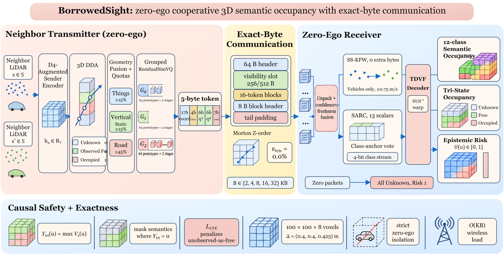

<div align="center">

# Paper2SVG-ultra

**Reference-Driven, Zero-GPU Editable Academic Overview SVG Generator**

*Feed your full paper PDF + a folder of top-venue reference figures → get a clean, editable hybrid `.svg` architecture figure ready for NeurIPS, CVPR, ICLR, SIGGRAPH, or Nature.*

[](LICENSE)
[](https://www.python.org/)
[-412991.svg)](https://platform.openai.com/docs/api-reference/responses)
[](#architecture)

**English** | [简体中文](README_ZH.md)

<br/>



<sub><b>Flagship Output of Paper2SVG-ultra</b> — generated end-to-end from the full PDF + reference figures of <a href="https://github.com/WYH302/BorrowedSight">BorrowedSight</a> (1600×712 editable hybrid <code>final.svg</code>, 16 draggable 3D isometric/LiDAR visual assets + 100% natively editable vector text, cards, and arrows, 0 linter errors, Vision Critic 9.2/10).</sub>

</div>

<details>
<summary><b>Click to inspect how Paper2SVG-ultra built this figure (Zero-GPU Asset Mask Overlay &amp; 700px 2-Column Print Preview)</b></summary>
<br/>
<table>
  <tr>
    <td align="center" width="50%">
      <br/>
      <sub><b>Zero-GPU Asset Mask Overlay</b> — 16 rich 3D LiDAR/voxel/occupancy/risk graphics automatically localized via our 0–1000 coordinate ruler and cropped cleanly with border flood-fill, while every band, box, arrow, and text label is rebuilt as pure editable SVG.</sub>
    </td>
    <td align="center" width="50%">
      <br/>
      <sub><b>Simulated 7-inch Two-Column Print Preview (700px)</b> — verified programmatically and visually for real-paper legibility before delivery.</sub>
    </td>
  </tr>
</table>
</details>

---

## Why We Built This (And What Went Wrong Along the Way)

Creating the main Figure 1 / Framework Overview for a top-conference paper is notoriously tedious: pure image generators produce great aesthetics but misspell text and cannot be edited, while pure LLM-written SVG code often degrades into stiff Visio-style boxes or turns domain imagery (faces, 3D meshes, tactile materials, optical fields) into crude cartoon polygons.

**Paper2SVG-ultra** stands on the shoulders of two remarkable open-source projects—[ResearAI/AutoFigure-Edit](https://github.com/ResearAI/AutoFigure-Edit) and [AIA-Academic-Illustrator](https://github.com/qwwzdyj/AIA-Academic-Illustrator-) (alongside insights from [happy-figure](https://github.com/datawhalechina/happy-figure) and [PaperGallery](https://github.com/LongHZ140516/PaperGallery))—and combines their core strengths into a **clean, zero-GPU, zero-SAM3 Python pipeline** powered solely by the OpenAI Responses API.

More importantly, instead of only showing cherry-picked wins, we want to share **the three real failure modes we hit while building this tool**—because fixing them turned out to matter far more than prompt wording alone:

| Iteration | Real Output (Same Paper PDF + Same 5 CVPR/ICLR Reference Figures) | What Actually Went Wrong & What We Learned |
| :---: | :---: | :--- |
| **v1**<br>*Wireframe Trap* |  | **Lesson 1 (Template Lock-in & Pure-Vector Downgrade):** Hardcoding default palette tokens in our Style Extractor washed out the reference folder's true borderless CVPR style into generic blue/copper/grey boxes. Worse, banning embedded `<image>` assets forced the model to redraw realistic faces with crude SVG polygons. |
| **v2**<br>*Overcrowding Trap* |  | **Lesson 2 (No Figure-1 Information Budget):** Once we unshackled Art-Direction extraction and added zero-GPU hybrid asset cropping, the visual style jumped dramatically—**but** a high-reasoning model faithfully extracted *every* detail from the PDF: **21 modules, 71 text labels, and 16 tiny sub-images** (including slice indices `[224:240]`, `55.9 FPS`, `Rank 16`, and loss thresholds), leaving almost zero breathing room. |
| **v3 (v1.x)**<br>*Subtraction Budgets* |  | **Lesson 3 (Subtraction Budgets + Dual-Resolution Linting):** Enforcing hard Figure-1 budgets (**3–4 stages, 6–9 modules, 12–24 labels, 3–6 hero visual assets, ≥35% whitespace**) + `700px` two-column simulation yielded a clean, airy banner—yet custom card rules could still drift into boxy gray PPT forms on complex papers. |
| **v2.1**<br>*1:1 Pixel-Exact Fast Engine* |  | **Lesson 4 (0.2s Pixel-Exact Segmentation + True 1:1 Coordinates + Smart Speedups):** Eliminated all four real failure modes we hit in v2.0 (wild crossing arrows, overlapping shapes, occluded/shifted text, and slow ~88 min runs): (1) capped arrow topology to 5–7 crisp straight arrows and standalone visual islands, (2) replaced slow VLM box guessing with a deterministic **0.2s zero-GPU Connected-Component + projection segmenter (`cc_zero_gpu`)** catching all 13 icons with ±0px precision, (3) fixed a subtle multimodal image-resize drift (`max_side=4096`) so SVG text/panels align 1:1 with zero coordinate shift, and (4) added per-stage reasoning effort caps — cutting Stage 5–6 editable SVG conversion to **~3.3 minutes** with **0 stray arrows, 0 overlapping shapes, 0 occluded text, and 0 linter errors**! |

<details>
<summary><b>Click to inspect the v2.1 0.2s CC Mask Overlay (13 icons) &amp; 700px Two-Column Print Preview</b></summary>
<br/>
<table>
  <tr>
    <td align="center" width="50%">
      <br/>
      <sub><b>0.2s Zero-GPU Pixel-Exact Mask Overlay (<code>samed.png</code>)</b> — 13 disjoint visual icons localized automatically in 0.2s with ±0px borders and zero swallowed text.</sub>
    </td>
    <td align="center" width="50%">
      <br/>
      <sub><b>Simulated 7-inch Two-Column Print Preview (700px)</b> — every title, sub-label, arrow, and photo remains sharp and legible at real paper width.</sub>
    </td>
  </tr>
</table>
</details>

*(Showcase example generated from our open-source paper [PhysFlow-SPI](https://github.com/WYH302/PhysFlow-SPI).)*

---

## Architecture

<div align="center">
  
</div>

### Key Engineering Highlights

1. **Simple I/O, Zero Heavy Dependencies**: Just drop a **full paper PDF** and a **folder of 2–5 reference figures** (`PNG/JPG/WEBP`). No PyTorch, no CUDA, no SAM3/Roboflow API keys, no `cairosvg` GTK/DLL pain on Windows (uses static Rust `resvg-py`).
2. **Primary Style Winner & Annotation Filtering (v1.1.0)**: Extracts true visual paradigms (borderless pastel pills, flat 2D multi-panel blueprints, 3D visual progression, wide colored arrows) from the **single strongest reference winner** (or a pinned `--primary-ref` file) without averaging conflicting styles, while ignoring hand-drawn review markings/captions and isolating reference text.
3. **Adaptive Density Tiering (`--density auto|concise|detailed`, v1.1.0)**: Automatically strips `Related Work` and `References` via `PyMuPDF` with neutral academic framing (preserving technical subsystem names on systems/security manuscripts). Dynamically switches between airy **`concise`** Figure-1 budgets (CVPR/NeurIPS/Nature, ≤30 labels) and **`detailed`** multi-panel systems budgets (IEEE S&P / USENIX / OSDI, 30–60 labels) so dense system diagrams never overflow pills or clip edges.
4. **Zero-GPU Full-Coverage Icon Extraction + 1:1 Native Pixel Reconstruction (v1.2.0)**: Instead of forcing the LLM to hand-draw ugly SVG doodles for icons, waveforms, neural networks, emblems, or hardware schematics, v1.2.0 adopts `AutoFigure-Edit`'s full-coverage paradigm **without SAM3 or GPU**: overlays a **1:1 edge-to-edge `0..1000` coordinate grid**, localizes up to 28 non-text visual graphics (`AF01..AFNN`), applies a pure-NumPy **pixel-boundary foreground snapper** + 4-sided stray-caption/border-frame stripper + edge flood-fill background removal, and reconstructs the editable SVG on the **exact 1:1 native pixel `viewBox`** of `stage1_draft.png` so the final editable `.svg` preserves the full aesthetic craft of the Stage-1 anchor!
5. **Bold-Aware Hard Linter + Visual-Fidelity Vision Critic (v1.2.0)**: Programmatically validates XML (`lxml`), audits bold/regular `Pillow` text widths, catches canvas edge clipping and `textLength` glyph squashing, protects content via semantic character & inventory-coverage retention, enforces an explicit **per-arrow direction audit** against `stage1_draft.png` and `[FLOW CONNECTIONS]`, grades side-by-side visual fidelity harshly (no metric gaming), and gracefully preserves the best completed SVG if an upstream `HTTP 503` hits a late round.
6. **SSE Streaming Built-In**: All `/v1/responses` calls stream continuously (`stream: true`, `store: false`), preventing reverse-proxy (e.g. Cloudflare HTTP 524) idle timeouts on long reasoning & SVG outputs.
7. **Bundled Interactive Web Workbench**: FastAPI UI with drag-and-drop uploads, density selector, editable `schema.md` resume (`--from-stage 4`), 700px two-column print preview, and a bundled MIT-licensed **`svg-edit`** canvas to drag, retype, and save directly back to `final.svg`.

<details>
<summary><b>What Changed in v2.1.0 &amp; v2.0.0 (AIA × AutoFigure-Edit + 0.2s CC Segmenter &amp; 10× Speedup)</b></summary>

- **v2.1.0 — Pixel-Exact Speed & Zero-Defect Polish**:
  - **0.2s Pixel-Exact Zero-GPU Segmenter (`cc_zero_gpu`, new default when SAM3 is absent)**: Replaces slow/noisy VLM bounding-box guessing with deterministic connected-component + projection-gap icon localization (`detect_icons_pixel_exact_cc`), finding every photo, 3D slab, manifold, and icon in `< 0.2s` with ±0px accuracy, zero missed photos, and zero swallowed titles.
  - **True 1:1 Native Coordinate Preservation (`max_side=4096`)**: Eliminates silent image downscaling before multimodal SVG reconstruction so text labels, panels, and arrows align 1:1 with zero fractional coordinate shift (both standard 2K figures and 4K upscaled figures).
  - **Clean Arrow Topology + Deterministic Sibling Text Collision Linter**: Caps Stage-3/4 figures to 5–7 crisp straight/orthogonal arrows with standalone visual islands (zero spaghetti arrows, zero giant title banners, zero raw `_` underscores), adds deterministic `<text>`-vs-`<text>` horizontal collision checks in `svg_linter.py`, and sanitizes LLM numeric typos (`width="95..0"`).
  - **Smart Per-Stage Reasoning Caps (~10× Faster)**: `resolve_stage_effort()` caps lightweight stages (`low`) and SVG generation (`medium`), bringing Stage 5–6 editable SVG conversion down to **~3.3 minutes** (and full PDF→SVG runs to ~7–10 minutes) with default `--draft-review-rounds 1 --critic-rounds 1` (Step 5.5 Post-Swap Polish on the real composited figure).
- **v2.0.0 — 3-Cut Surgical Giant Integration (AIA × AutoFigure-Edit)**:
  - **Cut 1 (AIA Front-End + Stage-4 Aesthetic & Anti-Copy Gate)**: Physical/optical/3D-slab visual metaphors, explicit anti-PPT-form blacklist, automated Stage-4 anti-copy/aesthetic gate + `--pause-after-draft`.
  - **Cut 2 (AutoFigure-Edit Native Back-End, `paper2svg/autofigure_engine.py`)**: Optional 4K upscale (`--upscale-4k`), pluggable SAM3 (`sam3_local` / `sam3_fal` / `sam3_roboflow`) or `cc_zero_gpu` / `vlm_zero_gpu`, pluggable neural matting (`rmbg2` / `birefnet` / `floodfill`), `<AF>01` template → deterministic swap → Step 5.5 Post-Swap Polish, plus `--input-figure <path.png>` direct conversion.
  - **Cut 3 (Windows-Bulletproof Infrastructure)**: SSE streaming with in-stream overload retry, zero-DLL Rust `resvg-py`, and bundled `svg-edit` Web Workbench.

</details>

---

## Quick Start

### 1. Clone & Install

Requires **Python 3.11+**.

```bash
git clone https://github.com/WYH302/Paper2SVG-ultra.git
cd Paper2SVG-ultra

# Option A: standard pip
python -m venv .venv
# Windows: .venv\Scripts\activate  |  macOS/Linux: source .venv/bin/activate
pip install -r requirements.txt

# Option B: uv (recommended, faster)
uv venv .venv --python 3.12
uv pip install --python .venv/bin/python -e .
```

### 2. Configure Your API (`.env`)

Copy `.env.example` to `.env` and fill in your OpenAI Responses API credentials (official OpenAI or any compatible `/v1/responses` endpoint supporting multimodal input + the built-in `image_generation` tool):

```bash
cp .env.example .env
```

```ini
OPENAI_BASE_URL=https://api.openai.com/v1
OPENAI_API_KEY=your_openai_api_key_here
MAIN_MODEL=gpt-5.4
REASONING_EFFORT=high
IMAGE_TOOL_MODEL=
IMAGE_QUALITY=high
SVG_MODE=hybrid_rich
DISABLE_RESPONSE_STORAGE=true
```

### 3. Run via Web Workbench (Recommended)

```bash
python run.py --serve
```

Then open **`http://127.0.0.1:8090`** in your browser.
*(Windows users can also simply double-click `启动网页工作台.bat` after creating `.venv` and `.env`.)*

### 4. Run via CLI

```bash
# Full 6-stage pipeline
python run.py \
  --paper path/to/your_paper.pdf \
  --refs path/to/reference_figures_folder \
  --out outputs/my_paper

# Optional: pause after Stage 3 to review/edit schema.md before drawing
python run.py --paper paper.pdf --refs refs/ --out outputs/my_paper --pause-after-schema

# Resume from Stage 4 after editing outputs/my_paper/schema.md
python run.py --paper paper.pdf --out outputs/my_paper --from-stage 4
```

<details>
<summary><b>CLI Options Reference</b></summary>

| Flag | Default | Description |
| :--- | :--- | :--- |
| `--paper` | *(required unless `--input-figure`)* | Path to full research paper PDF |
| `--input-figure` | `None` | Feed an existing high-res PNG/JPG directly into AutoFigure-Edit SVG conversion (skips Stages 1–4) |
| `--refs` | `None` | Folder of 2–5 top-venue reference images (PNG/JPG/WEBP) |
| `--primary-ref` | `None` | Pin a single reference image strictly as the Primary Style Winner |
| `--out` | `outputs/<stem>_<ts>` | Output directory |
| `--lang` | `auto` | Label language: `auto` (follow paper), `en`, or `zh` |
| `--archetype` | `auto` | Force one of 6 archetypes: `conceptual`, `framework`, `pipeline`, `architecture`, `taxonomy`, `teaser` |
| `--svg-engine` | `autofigure` | `autofigure` (v2.1 default: 0.2s CC/SAM3 → `<AF>` template → swap → polish) or `legacy` |
| `--svg-mode` | `hybrid_rich` | `hybrid_rich` (vector structure/text + cropped HD visuals) or `pure_vector` |
| `--seg-backend` | `auto` | `auto` (SAM3 if configured, else 0.2s pixel-exact `cc_zero_gpu`, or `vlm_zero_gpu`) |
| `--matting-backend` | `auto` | `auto` (RMBG-2.0 / BiRefNet if installed, else zero-GPU border floodfill) |
| `--upscale-4k` | `False` | Enable AutoFigure-Edit 4K proportional upscale (auto-enabled with SAM3) |
| `--draft-review-rounds` | `1` | AIA Stage-4 Aesthetic & Anti-Copy Gate max revision rounds (`0`–`3`) |
| `--density` | `auto` | Label density tier: `auto` (adaptive), `concise` (airy 10–18 labels), or `detailed` (dense multi-panel systems diagram) |
| `--critic-rounds` | `1` | AutoFigure post-swap visual polish (`1`) or template alignment + polish rounds (`0`–`4`) |
| `--main-model` | `.env` | Override reasoning / vision / SVG model |
| `--reasoning-effort` | `.env` | `none`, `low`, `medium`, `high`, or `xhigh` |
| `--image-model` | `.env` | Override Stage-1 `image_generation` tool model |
| `--from-stage` | `1` | Resume from stage `1`..`6` using cached intermediate artifacts |
| `--pause-after-schema` | `False` | Stop after Stage 3 (`schema.md`) for human-in-the-loop review |
| `--pause-after-draft` | `False` | Stop after Stage 4 (`stage1_draft.png`) to visually approve the raster anchor before SVG conversion |
| `--serve` | `False` | Launch the local FastAPI Web Workbench + `svg-edit` |

</details>

---

## Output Directory Artifacts

Every run saves clean, auditable artifacts under `outputs/<run_name>/`:

- `final.svg` — **Primary deliverable**: self-contained editable hybrid SVG (open in Adobe Illustrator, Figma, Inkscape, or built-in `svg-edit`)
- `final.png` — High-resolution 2× raster preview
- `print_preview_2col.png` — Simulated 7-inch two-column print preview (700px wide)
- `qa.md` — Programmatic linter stats + Vision Critic round-by-round audit log
- `stage1_draft.png` & `stage1_draft_masked.png` — Stage-1 visual anchor & cropped asset footprint mask
- `assets/` — Individual high-res cropped visual assets (PNG)
- `schema.md` — Editable visual blueprint & `[EXACT TEXT INVENTORY]`
- `style_guide.md` & `paper_method.md` — Distilled Art-Direction Style DNA & grounded method summary

---

## Limitations & Honest Notes

- **API Requirements**: Currently targets the **OpenAI Responses API** (`/v1/responses` with multimodal image inputs and built-in `image_generation` tool). Pure `/v1/chat/completions`-only endpoints are not yet wired.
- **Cutout Precision vs. SAM3**: Our zero-GPU border flood-fill background remover works cleanly for framed photos, light/tinted cards, and solid backdrops, but cannot match pixel-level matting models (SAM3 / RMBG-2.0) on complex hair or cluttered textured backgrounds.
- **Runtime & Cost**: With high/xhigh reasoning + 2 Critic rounds, a full run takes several minutes and consumes meaningful multimodal tokens. Use `--pause-after-schema` to confirm structure before rendering.

---

## Acknowledgements

This project was made possible by learning from and building upon the ideas of these excellent open-source projects (see [THIRD_PARTY_NOTICES.md](THIRD_PARTY_NOTICES.md)):

- [ResearAI/AutoFigure-Edit](https://github.com/ResearAI/AutoFigure-Edit) — Hybrid editable SVG reconstruction, asset masking, XML verification loop, and `svg-edit` workflow.
- [qwwzdyj/AIA-Academic-Illustrator-](https://github.com/qwwzdyj/AIA-Academic-Illustrator-) — Strict `Architect (Visual Schema) → Renderer → QA` design and exact text inventory discipline.
- [datawhalechina/happy-figure](https://github.com/datawhalechina/happy-figure) — Academic visual storytelling principles and structured schema design.
- [LongHZ140516/PaperGallery](https://github.com/LongHZ140516/PaperGallery) — Curated gallery for sourcing top-venue reference figures.
- [SVG-Edit](https://github.com/SVG-Edit/svgedit) — MIT-licensed in-browser SVG editor bundled in `web/vendor/svg-edit/`.

---

## Citation

If Paper2SVG-ultra helps streamline your paper writing, feel free to cite it:

```bibtex
@software{paper2svg_ultra_2026,
  author       = {WYH302},
  title        = {Paper2SVG-ultra: Reference-Driven Editable Academic Overview SVG Generator},
  year         = {2026},
  url          = {https://github.com/WYH302/Paper2SVG-ultra},
  license      = {MIT}
}
```

---

## Support / Sponsor (Optional)

Paper2SVG-ultra is completely free and open-source under the MIT License—feel free to use it freely! If it saved you hours before a conference deadline, a **Star ⭐** on GitHub is already the best encouragement. Voluntary coffee tips are always appreciated and never required:

<div align="center">
  
  <br/>
  <sub>WeChat Reward Code · 100% Voluntary ("Free users always welcome!")</sub>
</div>
