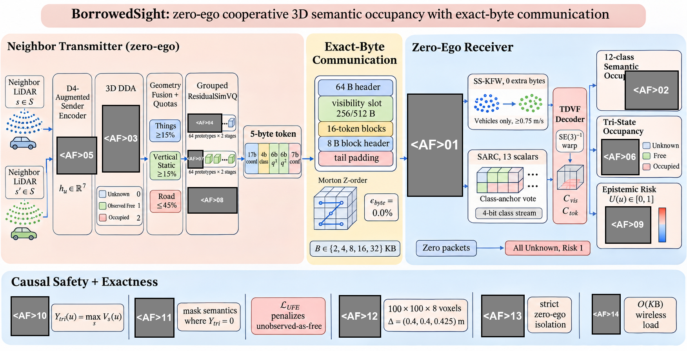
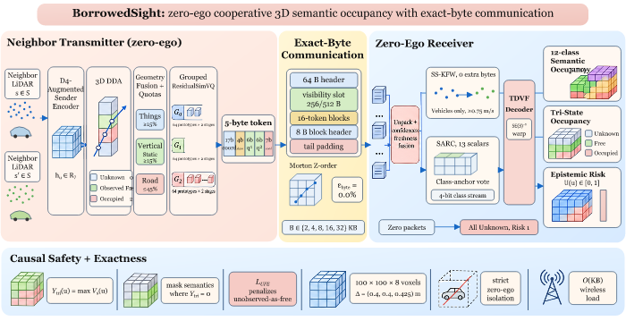

<div align="center">

# Paper2SVG-ultra v3.0

**Pure AutoFigure-Edit Pipeline for Editable Top-Venue Academic Figures**

*Feed your paper PDF (strict Method section only) + 1 style reference image (+ optional own-paper input/output images) → get a razor-clean, 100% natively editable `.svg` figure ready for CVPR, ECCV, NeurIPS, ICLR, IEEE S&P, or FAST.*

[](LICENSE)
[](https://www.python.org/)
[-412991.svg)](https://platform.openai.com/docs/api-reference/responses)
[](#architecture)

**English** | [简体中文](README_ZH.md)

<br/>


<sub><b>v3.0 Pure-Vector Showcase</b> — generated from the Method section of <a href="https://github.com/WYH302/BorrowedSight">BorrowedSight</a> + 1 style reference image (<code>1752×897</code> 100% native editable <code>final.svg</code>: 94 editable <code>&lt;text&gt;</code> labels, 53 vector <code>&lt;rect&gt;</code> blocks, 14 crisp isolated 3D voxel/LiDAR icons, 0 white patches, 0 wedge arrows, 0 box overflows).</sub>

</div>

<details>
<summary><b>Inspect Step 2 Icon Mask Overlay (<code>samed.png</code>) &amp; 700px Two-Column Print Preview</b></summary>
<br/>
<table>
  <tr>
    <td align="center" width="50%">
      <br/>
      <sub><b>Step 2 Icon Mask Overlay (<code>samed.png</code>)</b> — 14 visual icons localized cleanly without touching text cards or panels.</sub>
    </td>
    <td align="center" width="50%">
      <br/>
      <sub><b>Simulated 7-inch Two-Column Print Preview (700px)</b> — verified for real-paper legibility.</sub>
    </td>
  </tr>
</table>
</details>

---

## What Changed in v3.0.0 (Radical Simplification!)

After head-to-head ablations against unmodified upstream [ResearAI/AutoFigure-Edit](https://github.com/ResearAI/AutoFigure-Edit) across multiple domains (Computer Vision, Autonomous Driving 3D Occupancy, ML Systems, Security), we **permanently removed all over-engineered AIA / Style-DNA / Archetype / Legacy machinery** and standardized on the **single cleanest, highest-fidelity backbone**:

1. **Strict Method-Section-Only PDF Slicer (`paper2svg/pdf_parser.py`)**:
   - Recognizes Arabic (`3. Method`), IEEE Roman (`III. METHODOLOGY` → stops cleanly before `IV. EXPERIMENTS`), and Chinese headings (`3 方法`) via `PyMuPDF` in `<0.2s` (zero LLM cost).
   - Eliminates experimental metrics (`PSNR`/`FID`/ablation tables) from leaking into Figure 1. Also accepts `--method-file method.txt` directly.
2. **Pure AutoFigure-Edit Step 1 + 3-Line Anti-Copy Guard + Own-Paper Subject Images (`paper2svg/figure_gen.py`)**:
   - Uses upstream AutoFigure-Edit's exact 20-line single-style-reference prompt verbatim, adding ONLY a 3-line originality guard (forbidding copied faces/legends/charts from the style reference) and optional `--subject-images` so your paper's **real input/output photos** appear directly in the figure.
   - Optional `--pause-after-step1` lets you approve `figure.png` in ~2 minutes before running SVG conversion.
3. **Pluggable Step 2 Segmentation + Photo-Protected Step 3 Neural Matting (`paper2svg/gpu_worker.py`, `icon_utils.py`)**:
   - **Step 2 (`--seg-backend auto`)**: `sam3_local` (RTX GPU) → `sam3_fal` / `sam3_roboflow` → local CUDA zero-token **`GroundingDINO-Base`** + frame-stripped CC + strict VLM icon filter → zero-GPU frame-stripped CC + VLM filter.
   - **Step 3 (`--matting-backend auto`)**: Protects rectangular real photos/portraits/heatmaps (`opaque_rect` + optional rounded corners) so backgrounds are never chewed away; batch-mattes transparent icons via `briaai/RMBG-2.0` → zero-token CUDA **`ZhengPeng7/BiRefNet`** → zero-GPU perimeter `floodfill`.
   - **Lightweight `GPU_PYTHON` Bridge**: Point `GPU_PYTHON` in `.env` to any existing local CUDA PyTorch venv so this repository's `.venv` stays tiny while harnessing your NVIDIA GPU!
4. **0.05s Deterministic SVG Geometry Repair (`paper2svg/svg_postprocess.py`) + Windows Zero-DLL `resvg-py` Polish**:
   - Fixes malformed closed wedge arrow paths (`M...h...l...v...z` → clean 7-point block arrows), measures real Pillow glyph widths with CSS-safe inline `style="font-size:...px"` to eliminate box overflows, resolves same-row sibling `<text>` collisions, and nudges `<text>` away from `<image>` edges.
   - Runs default 2 visual alignment rounds (`1` template alignment + `1` post-swap polish on the real composited render) via Rust `resvg-py` (no Windows `cairosvg` DLL pain!), plus bundled MIT **`svg-edit`** in the Web Workbench.

---

## Quick Start

### 1. Install (Python 3.11+)

```bash
git clone https://github.com/WYH302/Paper2SVG-ultra.git
cd Paper2SVG-ultra

python -m venv .venv
# Windows: .venv\Scripts\activate  |  macOS/Linux: source .venv/bin/activate
pip install -r requirements.txt
```

### 2. Configure `.env`

```bash
cp .env.example .env
```

Fill in your OpenAI Responses API credentials (`OPENAI_BASE_URL`, `OPENAI_API_KEY`, `MAIN_MODEL`).
Optionally unlock local NVIDIA GPU or cloud SAM3 backends:
- **Cloud SAM3**: set `ROBOFLOW_API_KEY=...` or `FAL_KEY=...`
- **Local RTX GPU (Zero-Token GroundingDINO + BiRefNet)**: set `GPU_PYTHON=C:\path\to\cuda-venv\Scripts\python.exe` (or install `pip install -e ".[gpu]"`)
- **Local RTX GPU (Original SAM3 + RMBG-2.0)**: also set `HF_TOKEN=hf_xxx` after accepting model access on HuggingFace (`facebook/sam3`, `briaai/RMBG-2.0`).

### 3. Run via Web Workbench (Recommended)

```bash
python run.py --serve
```

Open **`http://127.0.0.1:8090`** (Windows users can double-click `启动网页工作台.bat`).

### 4. Run via CLI

```bash
# Full pipeline from PDF (auto-slices Method section ONLY) + 1 style reference image
python run.py \
  --paper path/to/paper.pdf \
  --style-ref path/to/style_ref.png \
  --out outputs/my_paper

# Include your paper's own real input/output images & pause after Step 1 to inspect figure.png
python run.py \
  --paper path/to/paper.pdf \
  --style-ref path/to/style_ref.png \
  --subject-images my_input.png my_output.png \
  --pause-after-step1 \
  --out outputs/my_paper

# Resume Step 2 -> 5.5 once happy with figure.png (or import any existing figure via --input-figure)
python run.py --out outputs/my_paper --from-step 2
python run.py --input-figure path/to/existing_figure.png --out outputs/converted
```

---

## Output Directory Artifacts (`outputs/<run>/`)

- `final.svg` — **Primary deliverable**: self-contained 100% natively editable vector SVG (Illustrator / Figma / Inkscape / built-in `svg-edit`)
- `final.png` & `print_preview_2col.png` — 2× HD preview & 700px two-column print simulation
- `figure.png` — Step 1 high-resolution figure
- `samed.png` & `boxlib.json` & `icons/` — Step 2 icon mask overlay, bounding boxes & matted transparent icons
- `template.svg` & `optimized_template.svg` — `<AF>` placeholder vector templates
- `method_section.txt` & `qa.md` — Sliced Method section & programmatic quality audit log

---

## Acknowledgements

Built upon and inspired by [ResearAI/AutoFigure-Edit](https://github.com/ResearAI/AutoFigure-Edit) and bundled with MIT-licensed [SVG-Edit](https://github.com/SVG-Edit/svgedit) (see [THIRD_PARTY_NOTICES.md](THIRD_PARTY_NOTICES.md)).

---

## Support / Sponsor (Optional)

Paper2SVG-ultra is completely free and open-source under the MIT License—feel free to use it freely! A GitHub **Star ⭐** is always the best encouragement; voluntary coffee tips are never required:

<div align="center">
  
  <br/>
  <sub>WeChat Reward Code · 100% Voluntary ("Free users always welcome!")</sub>
</div>
