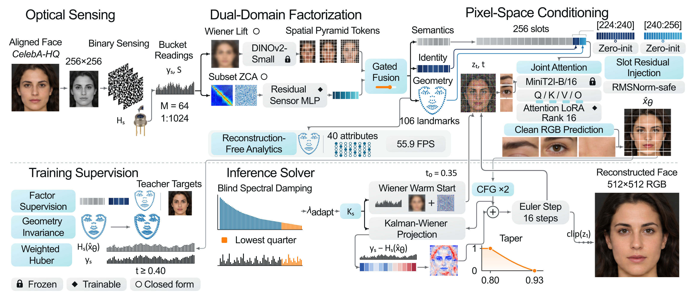
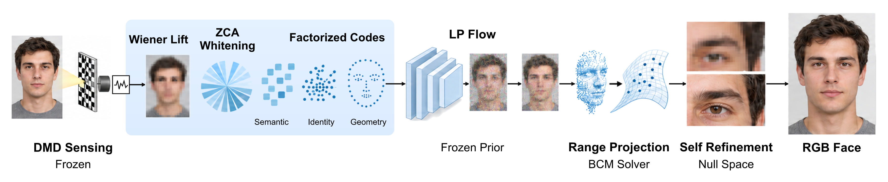
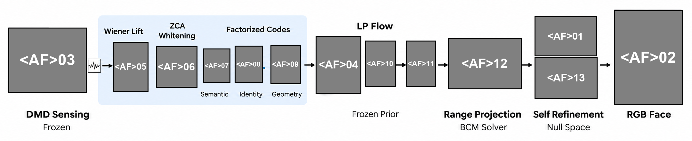
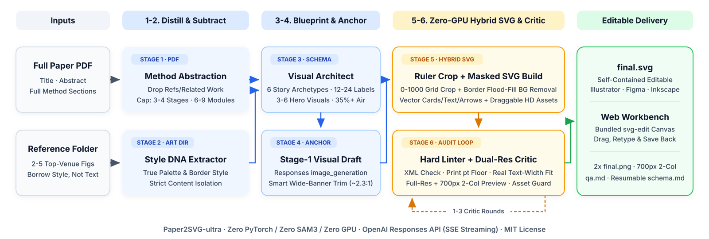

<div align="center">

# Paper2SVG-ultra

**参考图驱动、零 GPU 的顶会论文总体框架图可编辑 SVG 生成工具**

*输入你的整篇论文 PDF + 一个顶会参考图文件夹 → 输出结构清爽、排版舒展、可直接拖进 Illustrator / Figma / 内置编辑器精修的混合矢量 `.svg` 框架图。*

[](LICENSE)
[](https://www.python.org/)
[-412991.svg)](https://platform.openai.com/docs/api-reference/responses)
[](#系统架构)

[English](README.md) | **简体中文**

<br/>


<sub><b>Paper2SVG-ultra 旗舰实测成图</b> —— 由 <a href="https://github.com/WYH302/BorrowedSight">BorrowedSight</a> 整篇论文 PDF + 参考图文件夹端到端一键生成（<code>1600×712</code> 单文件可编辑混合 <code>final.svg</code>：16 个 3D 等轴测体素/激光雷达/占用栅格高清可拖拽视觉资产 + 100% 纯矢量可改文字、色带、框体与箭头，0 Linter 报错，视觉 Critic 终审 9.2/10）。</sub>

</div>

<details>
<summary><b>展开查看这张图是如何零 GPU 拆解重建的（16 资产遮罩图 &amp; 700px 双栏印刷实宽预览）</b></summary>
<br/>
<table>
  <tr>
    <td align="center" width="50%">
      <br/>
      <sub><b>零 GPU 视觉资产遮罩图</b> —— 通过 0–1000 坐标标尺精准裁切 16 处 3D 激光雷达/体素/风险场高清画面并智能去背嵌入，其余所有分区底色、圆角卡片、箭头与文字全部重建为纯净可编辑矢量 SVG。</sub>
    </td>
    <td align="center" width="50%">
      <br/>
      <sub><b>7 英寸双栏印刷实宽模拟图（700px）</b> —— 交付前自动通过双栏真实缩小尺寸可读性审查。</sub>
    </td>
  </tr>
</table>
</details>

---

## 项目初衷 & 真实踩坑演进（不只是代码，更是经验复盘）

每次赶 NeurIPS / CVPR / ICLR / SIGGRAPH / Nature 截稿前，画一张配得上论文质量的 **Figure 1 总体框架图** 往往最耗时：纯文生图模型虽然画风漂亮，但经常拼错公式/字母且无法修改；而纯让大模型手写 SVG 代码，又很容易退化成生硬的 Visio 细线方框，甚至把人脸、3D 模型、材料纹理、光学实验图降维画成廉价简笔画。

**Paper2SVG-ultra** 站在两个优秀开源项目的肩膀上——吸收了 [ResearAI/AutoFigure-Edit](https://github.com/ResearAI/AutoFigure-Edit) 的混合可编辑矢量与多轮优化思路、以及 [AIA-Academic-Illustrator](https://github.com/qwwzdyj/AIA-Academic-Illustrator-) 的「蓝图先于渲染 + 精确文字白名单」设计（并参考了 [happy-figure](https://github.com/datawhalechina/happy-figure) 与 [PaperGallery](https://github.com/LongHZ140516/PaperGallery) 的科研视觉经验）——用一套**干净、零 GPU、零 SAM3 外部依赖**的 Python 工程把整条链路打通。

相比只放“精挑细选的最好一张图”，我们更想坦诚展示开发过程中**亲身踩过的三个典型大坑**——因为真正决定出图质量的，恰恰是解决这三个问题：

| 迭代版本 | 真实对比效果（同一篇论文 PDF + 同一组 5 张顶会参考图） | 踩到的真实问题与核心观察 |
| :---: | :---: | :--- |
| **v1**<br>*流程图模具坑* |  | **坑 1（风格模板写死 + 纯矢量降维）：** Style Extractor 里不小心留了预设色板与圆角线宽示例，结果无论参考图多惊艳都被洗成了千篇一律的“灰蓝铜套娃黑框流程图”；更糟的是强行禁用 `<image>` 嵌图，把真实人脸逼成了卡通简笔画。 |
| **v2**<br>*信息过载坑* |  | **坑 2（高推理模型不懂给 Figure 1 做减法）：** 解放参考图艺术指导并接入零 GPU 混合裁切嵌图后，画风立刻有了顶会质感——**但**深度推理模型把正文里的每个实现细节都抽了出来：**21 个模块、71 条文字、16 张碎小图**（连 `[224:240]` 切片、`55.9 FPS`、`Rank 16`、损失阈值全塞进主图），画面密密麻麻几乎没有留白。 |
| **v3 (v1.x)**<br>*减法预算版* |  | **坑 3 破局（信息减法硬预算 + 双栏实宽硬校验）：** 加入硬上限与 `700px` 双栏体检后画风干净了许多——但自研卡片规则在复杂方法论文上仍容易退化成“大灰框套红黄子框套药丸”的土味表单感。 |
| **v2.1**<br>*1:1 像素级极速版* |  | **坑 4 彻底根治（逐一消灭箭头乱指 / 图形重叠 / 文字偏移 / 生成太慢）：** 针对 v2.0 暴露的 4 个核心痛点做彻底工程重写：① 严格限制 5–7 条水平/正交干爽箭头与独立视觉孤岛；② 用确定性 **0.2 秒零 GPU 连通域 + 投影分割器（`cc_zero_gpu`）** 替代缓慢易漏框的 VLM 猜坐标，±0px 抓全全部 13 个视觉图标；③ 根治多模态发图静默缩放导致的 `0.83×` 文字整体左移（`max_side=4096` 原生 1:1 坐标对齐）；④ 引入分阶段智能推理深度上限，Stage 5–6 转可编辑 SVG 从 ~88 分钟压缩到 **~3.3 分钟**，实现 **0 乱指箭头、0 图形重叠、0 文字遮挡、0 Linter 硬错误**！ |

<details>
<summary><b>展开查看 v2.1 的 0.2s 像素级资产遮罩图（13 图标） & 700px 双栏印刷实宽模拟图</b></summary>
<br/>
<table>
  <tr>
    <td align="center" width="50%">
      <br/>
      <sub><b>0.2s 零 GPU 像素级遮罩图（<code>samed.png</code>）</b> —— 0.2 秒自动锁死 13 处人像/光路/3D 堆叠/流形/局部放大，±0px 紧贴且绝不吞文字。</sub>
    </td>
    <td align="center" width="50%">
      <br/>
      <sub><b>7 英寸双栏印刷实宽模拟图（700px）</b> —— 缩到真实论文双栏宽度后，每个标题、子标签、箭头与图像均锐利清晰。</sub>
    </td>
  </tr>
</table>
</details>

*（上述案例使用已开源论文 [PhysFlow-SPI](https://github.com/WYH302/PhysFlow-SPI) 实测生成。）*

---

## 系统架构

<div align="center">
  
</div>

### 核心工程设计

1. **极简输入、零重型依赖**：只需 **整篇论文 PDF** + **参考图文件夹（2–5 张 PNG/JPG）**。无需 PyTorch、无需显卡、无需额外注册 SAM3 / Roboflow API Key，也不用折腾 Windows 上极易报错的 `cairosvg`（内置纯 Rust 零 DLL 的 `resvg-py`）。
2. **单一主参考优胜锁定 + 去批注干扰（v1.1.0）**：多张参考图不再生硬“平均融合”，而是选出最契合的**唯一主参考优胜者**（或用 `--primary-ref` 锁定单图）统一提取视觉范式与色板，并自动忽略参考图上的审稿红笔批注、水印与图注文字，严格隔离内容。
3. **自适应信息密度分级（`--density auto|concise|detailed`，v1.1.0）**：`PyMuPDF` 自动剥离 `Related Work` 与 `References`，并以学术中性框架忠实保留系统/安全类论文的真实模块名称；根据清单自动在**精简顶会风**（CVPR/NeurIPS/Nature，≤30 标签）与**系统架构详图**（IEEE S&P / USENIX / OSDI 多面板架构，30–60 标签）之间平滑切换字号与留白预算。
4. **零 GPU 全量视觉图标抠图 + 原生 1:1 像素复刻（v1.2.0）**：彻底告别让 LLM 手写 `<path>` 盲画丑陋涂鸦——在零显卡、零 SAM3 条件下全面复现 `AutoFigure-Edit` 精髓：在底图上叠加**同分辨率零外边距 `0..1000` 标尺**，全量定位多达 28 处非文字图标/徽标/波形/神经网络/DAG/设备/缩略图（`AF01..AFNN`），通过纯 NumPy **前景像素边缘吸附** + **4 侧残字/残框自动剥离** + 边缘泛洪透明去背，在底图**原生 1:1 像素 `viewBox`** 上精准重建可编辑 `.svg`，让终稿美学质感几乎 1:1 复刻 Stage-1 底图！
5. **粗体感知 Linter + 视觉还原度严审 Critic（v1.2.0）**：确定性校验 XML（`lxml`）、按粗体/常规真实字宽测算框体溢出、硬拦截画布越界与 `textLength` 扁字挤压、采用语义覆盖率防回滚守卫；Stage 6 强制逐条执行 **箭头方向审计（`arrow_direction_audit`）** 与底图逐面板美学对比，并对上游临时 `HTTP 503` 优雅保底输出最佳轮次成果。
6. **全链路 SSE 流式防超时**：所有 `/v1/responses` 请求均走 `stream: true` + `store: false`（保护未发表论文隐私，同时彻底避免 Cloudflare 等反向代理 100 秒 HTTP 524 超时）。
7. **开箱即用本地网页工作台**：内置 FastAPI 前端与 MIT 协议 `svg-edit` 画布，支持密度档位切换、蓝图暂停编辑续跑（`--from-stage 4`）、草图 vs 终稿对比，以及浏览器内拖拽改字并一键写回 `final.svg`。

<details>
<summary><b>v2.1.0 &amp; v2.0.0 核心升级：0.2s 像素级抠图、1:1 原生坐标对齐与 10× 提速</b></summary>

- **v2.1.0 — 根治箭头乱指、图形重叠、文字错位与耗时过长**：
  - **0.2 秒零 GPU 像素级连通域分割器（`cc_zero_gpu`，未装 SAM3 时默认启用）**：用确定性纯 NumPy 连通域 + 水平/垂直投影间隙分割替代慢且不稳定的 VLM 猜坐标，`0.2s` 抓全所有真实照片、3D 堆叠、流形与图标（±0px、零重叠、零漏图、零吞标题）。
  - **原生 1:1 像素坐标保真（`max_side=4096`）**：彻底修复发送多模态图片时静默缩图引发的 `0.83×` 文字/色块集体错位，无论 2K 还是 4K 底图均保证文字、色带、箭头与嵌入图标 1:1 严丝合缝。
  - **极简拓扑 + 确定性同行文字碰撞检测**：严控 5–7 条干净直线/正交箭头与独立视觉孤岛（零乱指箭头、零废标题横幅、零裸下划线 `_`），在 `svg_linter.py` 新增同行 `<text>` 水平碰撞检测，并自动修复大模型偶发双小数点笔误（如 `width="95..0"`）。
  - **分阶段智能推理深度上限（提速 ~10×）**：`resolve_stage_effort()` 为各阶段匹配最优推理档位（轻量解析/质检用 `low`，蓝图与 SVG 重建用 `medium`），默认 `--draft-review-rounds 1 --critic-rounds 1`（直奔 Step 5.5 贴图后实景终检抛光），Stage 5–6 转可编辑 SVG 仅需 **~3.3 分钟**！
- **v2.0.0 — 站在双巨人肩膀上的「三刀精准手术」（AIA × AutoFigure-Edit）**：
  - **第一刀（AIA 真身前端 + Stage-4 审美防抄袭闸门）**：物理/光路/3D 实体描述 + 封杀 PPT 灰框表单 + 自动防抄袭审图闸门与 `--pause-after-draft`。
  - **第二刀（AutoFigure-Edit 原生引擎，`paper2svg/autofigure_engine.py`）**：可选 4K 放大（`--upscale-4k`）、可插拔 SAM3 / `cc_zero_gpu` / `vlm_zero_gpu`、可插拔神经抠图（`rmbg2` / `birefnet` / `floodfill`）、`<AF>01` 模板复刻 → 确定性透明图标替换 → Step 5.5 贴图后终检，并支持 `--input-figure <figure.png>` 一键直通转 SVG。
  - **第三刀（Windows 稳健底座）**：全链路 OpenAI Responses SSE 流式防超时与流内过载重试、纯 Rust 零 DLL 的 `resvg-py`、内置 `svg-edit` 网页工作台。

</details>

---

## 快速上手

### 1. 安装环境（Python 3.11+）

```bash
git clone https://github.com/WYH302/Paper2SVG-ultra.git
cd Paper2SVG-ultra

# 方式一：标准 pip
python -m venv .venv
# Windows: .venv\Scripts\activate  |  macOS/Linux: source .venv/bin/activate
pip install -r requirements.txt

# 方式二：uv（推荐，安装更快）
uv venv .venv --python 3.12
uv pip install --python .venv/bin/python -e .
```

### 2. 配置 API（`.env`）

复制 `.env.example` 为 `.env`，填入支持 **OpenAI Responses API**（多模态视觉 + 内置 `image_generation` 工具）的官方或兼容网关配置：

```bash
cp .env.example .env
```

```ini
OPENAI_BASE_URL=https://api.openai.com/v1
OPENAI_API_KEY=你的API_Key
MAIN_MODEL=gpt-5.4
REASONING_EFFORT=high
IMAGE_TOOL_MODEL=
IMAGE_QUALITY=high
SVG_MODE=hybrid_rich
DISABLE_RESPONSE_STORAGE=true
```

### 3. 启动网页工作台（推荐）

```bash
python run.py --serve
```

浏览器打开 **`http://127.0.0.1:8090`** 即可上传 PDF 与参考图文件夹出图并在线拖拽精修。
*(Windows 用户配好 `.venv` 和 `.env` 后，可直接双击根目录的 `启动网页工作台.bat` 或 `一键画图_命令行版.bat`。)*

### 4. 命令行一键运行（CLI）

```bash
# 完整 6 阶段顶配出图
python run.py \
  --paper path/to/your_paper.pdf \
  --refs path/to/reference_figures_folder \
  --out outputs/my_paper

# 先生成视觉蓝图 schema.md 暂停，确认/微调后再画图
python run.py --paper paper.pdf --refs refs/ --out outputs/my_paper --pause-after-schema

# 改完 outputs/my_paper/schema.md 后从 Stage 4 断点续跑
python run.py --paper paper.pdf --out outputs/my_paper --from-stage 4
```

---

## 输出目录产物（`outputs/<任务名>/`）

- `final.svg` — **主交付物**：自包含可编辑混合矢量 SVG（支持 Illustrator / Figma / Inkscape / 内置 `svg-edit`）
- `final.png` — 2× 高清 PNG 预览图
- `print_preview_2col.png` — 700px 双栏印刷实宽模拟图
- `qa.md` — 程序化 Linter 指标 + 视觉 Critic 逐轮审稿报告
- `stage1_draft.png` / `stage1_draft_masked.png` — Stage-1 构图底稿与资产裁切遮罩图
- `assets/` — 裁切出的独立高清视觉素材 PNG
- `schema.md` / `style_guide.md` / `paper_method.md` — 蓝图、风格基因与论文方法摘要

---

## 局限性与坦诚说明

- **接口要求**：当前基于 **OpenAI Responses API**（`/v1/responses` + `image_generation` 工具）；暂未适配仅支持传统 `/v1/chat/completions` 的接口。
- **抠图边界**：零 GPU 边缘泛洪去背对相框式样图、浅底卡片与干净背景上的物体表现很稳，但遇到毛发、半透明复杂网格等极端前景时精度不如 SAM3 / RMBG-2.0。
- **耗时与成本**：高推理强度 + 2 轮视觉 Critic 精修通常需要数分钟并消耗较多 Token，建议对重要主图先用 `--pause-after-schema` 确认结构蓝图再渲染。

---

## 致谢

本项目深受以下优秀开源社区项目启发并站在其肩膀上微调构建（详见 [THIRD_PARTY_NOTICES.md](THIRD_PARTY_NOTICES.md)）：

- [ResearAI/AutoFigure-Edit](https://github.com/ResearAI/AutoFigure-Edit)
- [qwwzdyj/AIA-Academic-Illustrator-](https://github.com/qwwzdyj/AIA-Academic-Illustrator-)
- [datawhalechina/happy-figure](https://github.com/datawhalechina/happy-figure)
- [LongHZ140516/PaperGallery](https://github.com/LongHZ140516/PaperGallery)
- [SVG-Edit](https://github.com/SVG-Edit/svgedit)（MIT 协议，内置于 `web/vendor/svg-edit/`）

---

## 引用格式

如果 Paper2SVG-ultra 在你投稿画图时帮上了忙，欢迎引用：

```bibtex
@software{paper2svg_ultra_2026,
  author       = {WYH302},
  title        = {Paper2SVG-ultra: Reference-Driven Editable Academic Overview SVG Generator},
  year         = {2026},
  url          = {https://github.com/WYH302/Paper2SVG-ultra},
  license      = {MIT}
}
```

---

## 支持与随缘打赏（可选）

本项目基于 MIT 协议永久免费开源，**完全欢迎白嫖**！如果它刚好在截稿前救了你几个小时，点一个 **Star ⭐** 就是最大的鼓励；如果愿意随缘请作者喝杯咖啡，也欢迎扫码支持（想给就给、不给也完全没关系）：

<div align="center">
  
  <br/>
  <sub>微信赞赏码 · 自愿随缘，也欢迎白嫖 ☕</sub>
</div>
