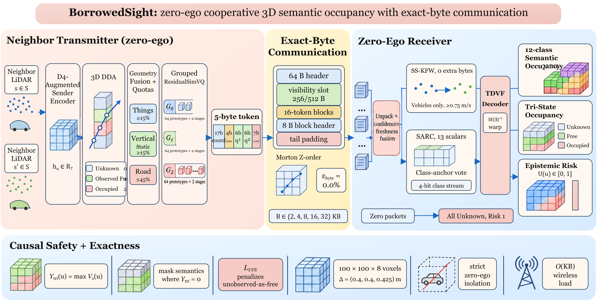
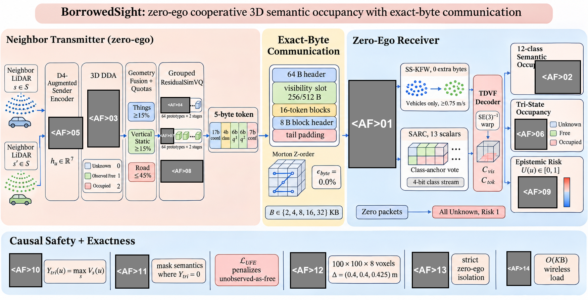
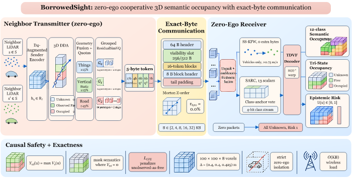

<div align="center">

# Paper2SVG-ultra v3.0

**纯净 AutoFigure-Edit 范式的顶会论文可编辑 SVG 生成工具**

*输入论文 PDF（自动只抽 Method 章节）+ 1 张顶会风格参考图（可选本论文自有输入/输出实拍图）→ 输出 100% 纯原生可编辑、零白补丁、可直接拖进 Illustrator / Figma / 内置 `svg-edit` 精修的 `.svg` 论文框架图。*

[](LICENSE)
[](https://www.python.org/)
[-412991.svg)](https://platform.openai.com/docs/api-reference/responses)
[](#v300-核心精简与升级)

[English](README.md) | **简体中文**

<br/>



<sub><b>v3.0 纯矢量实测成图</b> —— 由开源论文 <a href="https://github.com/WYH302/BorrowedSight">BorrowedSight</a> 的 Method 章节 + 1 张风格参考图生成（<code>1752×897</code> 纯原生可编辑 <code>final.svg</code>：94 个原生可改 <code>&lt;text&gt;</code>、53 个矢量 <code>&lt;rect&gt;</code>、14 个独立 3D 体素/LiDAR 透明图标，0 白色补丁、0 畸形箭头、主框 0 溢出）。</sub>

</div>

<details>
<summary><b>展开查看 Step 2 图标定位掩码（<code>samed.png</code>）与 700px 双栏印刷实宽模拟图</b></summary>
<br/>
<table>
  <tr>
    <td align="center" width="50%">
      <br/>
      <sub><b>Step 2 图标掩码（<code>samed.png</code>）</b> —— 精准锁死 14 个独立图形/3D 立方体/车辆图标，绝不吞并文字卡片与大面板边框。</sub>
    </td>
    <td align="center" width="50%">
      <br/>
      <sub><b>7 英寸双栏印刷实宽模拟图（700px）</b> —— 缩至真实双栏印刷宽度依然锐利清晰。</sub>
    </td>
  </tr>
</table>
</details>

---

## v3.0.0 核心精简与升级（删繁就简，只留唯一验证跑通的最强主干）

经过多领域实测（CV、自动驾驶 3D 占据、系统安全、ML 系统）与原版 [ResearAI/AutoFigure-Edit](https://github.com/ResearAI/AutoFigure-Edit) 的严格横向对比，v3.0 **彻底删除了冗余的 AIA Architect / Style DNA / 6 大原型 / 旧版 SVG 引擎**，只保留一条极致干净、稳健可控的主干链路：

1. **Method 章节精准切片（`paper2svg/pdf_parser.py`，0.2 秒零 LLM）**：
   - 同时兼容阿拉伯数字（`3. Method`）、IEEE 罗马数字（`III. METHODOLOGY` → 严格截断在 `IV. EXPERIMENTS` 之前）与中文标题（`3 方法`），杜绝实验指标（PSNR/FID/消融表）污染主架构图；也支持直接传 `--method-file method.txt`。
2. **原版 AutoFigure-Edit Step 1 + 3 行防抄袭护栏 + 本论文自有实拍图（`paper2svg/figure_gen.py`）**：
   - 原汁原味保留原版 20 行单风格参考图提示词，仅追加 3 行原创护栏（严禁抄参考图人脸/图例/雷达图），并支持 `--subject-images` 直接传入**自己论文里的真实输入/输出图**；支持 `--pause-after-step1`（2 分钟看完底图满意再转 SVG）。
3. **可插拔 Step 2 图标分割 + 实拍图保护 Step 3 神经抠图（`paper2svg/gpu_worker.py`）**：
   - **Step 2（`--seg-backend auto`）**：`sam3_local`（本地 GPU 真 SAM3）→ `sam3_fal` / `sam3_roboflow`（云端真 SAM3）→ 本地 CUDA 免鉴权 **`GroundingDINO-Base`** + 去大框连通域 + 严格 VLM 过滤 → 零 GPU 去大框连通域 + VLM 过滤。
   - **Step 3（`--matting-backend auto`）**：自动识别并保护方形实拍图/人脸/热力图（原图加圆角保留，绝不啃背景）；非照片图标批量走 `briaai/RMBG-2.0` → 免鉴权 CUDA **`ZhengPeng7/BiRefNet`** → 零 GPU 边缘 `floodfill`。
   - **轻量 `GPU_PYTHON` 桥接**：在 `.env` 配置已有 CUDA 虚拟环境路径即可调用本地 RTX 显卡，无需在主 `.venv` 里重复装 PyTorch！
4. **0.05 秒确定性 SVG 几何自修（`paper2svg/svg_postprocess.py`）+ Windows 零 DLL `resvg-py` 终检**：
   - 自动将 LLM 误写的闭合三角楔箭头（`M...h...l...v...z`）重建为 7 点对称矢量箭头；用 Pillow 真字体宽度 + 内联 `style="font-size:...px"` 自动缩进溢出文本框的标签；自动消解同行兄弟 `<text>` 碰撞与 `<text>` 压图标；默认跑 2 轮渲染对齐（1 轮模板对齐 + 1 轮贴图后实景终检），配合内置 MIT `svg-edit` 拖拽微调。

---

## 快速上手

### 1. 安装环境（Python 3.11+）

```bash
git clone https://github.com/WYH302/Paper2SVG-ultra.git
cd Paper2SVG-ultra

python -m venv .venv
# Windows: .venv\Scripts\activate  |  macOS/Linux: source .venv/bin/activate
pip install -r requirements.txt
```

### 2. 配置 `.env`

```bash
cp .env.example .env
```

填入 OpenAI Responses API 凭据（`OPENAI_BASE_URL`、`OPENAI_API_KEY`、`MAIN_MODEL`）。
可选开启本地显卡 / 真 SAM3 加速：
- **云端真 SAM3**：填 `ROBOFLOW_API_KEY=...` 或 `FAL_KEY=...`
- **本地 NVIDIA GPU（免 Token 跑 GroundingDINO + BiRefNet）**：填 `GPU_PYTHON=你的CUDA环境\Scripts\python.exe`（或 `pip install -e ".[gpu]"`）
- **本地 NVIDIA GPU（原版真 SAM3 + RMBG-2.0）**：在 HuggingFace 同意 `facebook/sam3` / `briaai/RMBG-2.0` 协议后填入 `HF_TOKEN=hf_xxx`。

### 3. 启动网页工作台（推荐）

```bash
python run.py --serve
```

浏览器打开 **`http://127.0.0.1:8090`**（Windows 可直接双击 `启动网页工作台.bat`）。

### 4. 命令行运行（CLI）

```bash
# 从 PDF 自动切片 Method 章节 + 1 张风格参考图 -> 可编辑 SVG
python run.py \
  --paper path/to/paper.pdf \
  --style-ref path/to/style_ref.png \
  --out outputs/my_paper

# 带上本论文自己的真实输入/输出图，且在 Step 1 出完底图后先暂停审阅
python run.py \
  --paper path/to/paper.pdf \
  --style-ref path/to/style_ref.png \
  --subject-images my_input.png my_output.png \
  --pause-after-step1 \
  --out outputs/my_paper

# 满意底图后一键从 Step 2 转可编辑 SVG（或用 --input-figure 直接导入任意高清底图）
python run.py --out outputs/my_paper --from-step 2
python run.py --input-figure path/to/existing_figure.png --out outputs/converted
```

---

## 致谢

本项目基于 [ResearAI/AutoFigure-Edit](https://github.com/ResearAI/AutoFigure-Edit) 核心范式构建，并内置 MIT 协议的 [SVG-Edit](https://github.com/SVG-Edit/svgedit)（详见 [THIRD_PARTY_NOTICES.md](THIRD_PARTY_NOTICES.md)）。

---

## 支持与随缘打赏（可选）

本项目基于 MIT 协议永久免费开源，**完全欢迎白嫖**！如果刚好在截稿前帮上了忙，点一个 **Star ⭐** 就是最大的鼓励；随缘打赏完全自愿：

<div align="center">
  
  <br/>
  <sub>微信赞赏码 · 自愿随缘，也欢迎白嫖 ☕</sub>
</div>
