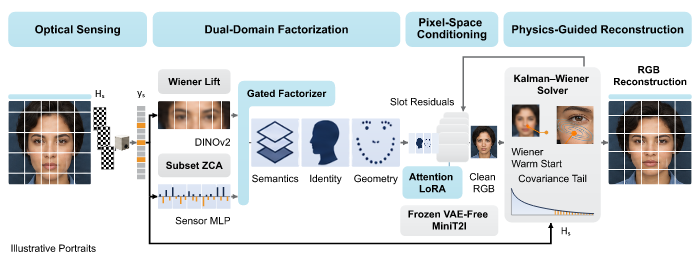
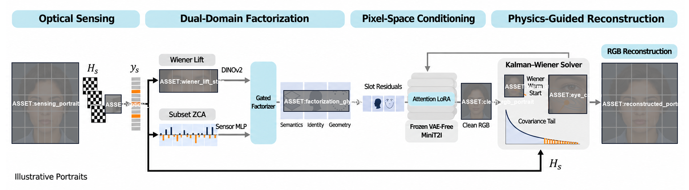

<div align="center">

# Paper2SVG-ultra

**参考图驱动、零 GPU 的顶会论文总体框架图可编辑 SVG 生成工具**

*输入你的整篇论文 PDF + 一个顶会参考图文件夹 → 输出结构清爽、排版舒展、可直接拖进 Illustrator / Figma / 内置编辑器精修的混合矢量 `.svg` 框架图。*

[](LICENSE)
[](https://www.python.org/)
[-412991.svg)](https://platform.openai.com/docs/api-reference/responses)
[](#系统架构)

[English](README.md) | **简体中文**

</div>

---

## 项目初衷 & 真实踩坑演进（不只是代码，更是经验复盘）

每次赶 NeurIPS / CVPR / ICLR / SIGGRAPH / Nature 截稿前，画一张配得上论文质量的 **Figure 1 总体框架图** 往往最耗时：纯文生图模型虽然画风漂亮，但经常拼错公式/字母且无法修改；而纯让大模型手写 SVG 代码，又很容易退化成生硬的 Visio 细线方框，甚至把人脸、3D 模型、材料纹理、光学实验图降维画成廉价简笔画。

**Paper2SVG-ultra** 站在两个优秀开源项目的肩膀上——吸收了 [ResearAI/AutoFigure-Edit](https://github.com/ResearAI/AutoFigure-Edit) 的混合可编辑矢量与多轮优化思路、以及 [AIA-Academic-Illustrator](https://github.com/qwwzdyj/AIA-Academic-Illustrator-) 的「蓝图先于渲染 + 精确文字白名单」设计（并参考了 [happy-figure](https://github.com/datawhalechina/happy-figure) 与 [PaperGallery](https://github.com/LongHZ140516/PaperGallery) 的科研视觉经验）——用一套**干净、零 GPU、零 SAM3 外部依赖**的 Python 工程把整条链路打通。

相比只放“精挑细选的最好一张图”，我们更想坦诚展示开发过程中**亲身踩过的三个典型大坑**——因为真正决定出图质量的，恰恰是解决这三个问题：

| 迭代版本 | 真实对比效果（同一篇论文 PDF + 同一组 5 张顶会参考图） | 踩到的真实问题与核心观察 |
| :---: | :---: | :--- |
| **v1**<br>*流程图模具坑* |  | **坑 1（风格模板写死 + 纯矢量降维）：** Style Extractor 里不小心留了预设色板与圆角线宽示例，结果无论参考图多惊艳都被洗成了千篇一律的“灰蓝铜套娃黑框流程图”；更糟的是强行禁用 `<image>` 嵌图，把真实人脸逼成了卡通简笔画。 |
| **v2**<br>*信息过载坑* |  | **坑 2（高推理模型不懂给 Figure 1 做减法）：** 解放参考图艺术指导并接入零 GPU 混合裁切嵌图后，画风立刻有了顶会质感——**但**深度推理模型把正文里的每个实现细节都抽了出来：**21 个模块、71 条文字、16 张碎小图**（连 `[224:240]` 切片、`55.9 FPS`、`Rank 16`、损失阈值全塞进主图），画面密密麻麻几乎没有留白。 |
| **v3**<br>*Paper2SVG-ultra* |  | **坑 3 破局（信息减法硬预算 + 双栏实宽硬校验）：** 在 Stage 1 / 3 / 6 写入硬上限（**3–4 阶段、6–9 高层模块、12–24 条标签、3–6 个大视觉主角、≥35% 纯白呼吸空间**），再叠加 `700px` 双栏模拟体检，直接跑出 **24/24 精确标签、8 个高清可拖拽视觉主角、55.6% 留白、0 错 0 警** 的清爽顶会主图。 |

<details>
<summary><b>展开查看 v3 的 700px 双栏印刷实宽模拟图 & 零 GPU 资产遮罩图</b></summary>
<br/>
<table>
  <tr>
    <td align="center" width="50%">
      <br/>
      <sub><b>7 英寸双栏印刷实宽模拟图（700px）</b> —— 缩到真实论文双栏宽度后，每个模块与标签依然清晰易读。</sub>
    </td>
    <td align="center" width="50%">
      <br/>
      <sub><b>零 GPU 视觉资产遮罩图</b> —— 精确标出从 Stage-1 底稿裁切的高清视觉区，防止 Stage 5 在嵌图下方重复手画。</sub>
    </td>
  </tr>
</table>
</details>

*（上述案例使用已开源论文 [PhysFlow-SPI](https://github.com/WYH302/PhysFlow-SPI) 实测生成。）*

---

## 系统架构

<div align="center">
  
</div>

### 核心工程设计

1. **极简输入、零重型依赖**：只需 **整篇论文 PDF** + **参考图文件夹（2–5 张 PNG/JPG）**。无需 PyTorch、无需显卡、无需额外注册 SAM3 / Roboflow API Key，也不用折腾 Windows 上极易报错的 `cairosvg`（内置纯 Rust 零 DLL 的 `resvg-py`）。
2. **艺术总监级 Style DNA（借骨架与画风，绝不借画中内容）**：忠实提炼参考图文件夹的真实视觉范式（无边框柔和药丸、3D 实体演进、彩色宽箭头、色带标题栏）与真实色板，同时严格隔离参考图里的文字和模块。
3. **Figure 1 信息减法硬预算**：`PyMuPDF` 分章节自动剥离 `Related Work` 与 `References`；限制高层抽象在 3–4 阶段 / 6–9 模块 / 12–24 标签以内，自动拦截超参数、张量切片下标与实验数字噪音。
4. **零 GPU 混合可编辑 SVG**：在 Stage-1 视觉锚图上叠加 `0..1000` 精密坐标标尺，让多模态模型精准定位高颜值视觉资产（真实样本图、3D 物体、材料纹理、硬件/光谱图），本地高清裁切 + 边缘泛洪智能去背，再配合灰色遮罩图生成单文件自包含 `.svg`（同时写入 `href` 与 `xlink:href` 兼容 Illustrator / Figma / Inkscape / `svg-edit`）——**所有文字、公式、卡片、箭头 100% 纯矢量可改，高清视觉资产也可单独拖动缩放**。
5. **硬规则 Linter + 双分辨率视觉 Critic 闭环**：确定性校验 XML 合法性（`lxml`）、反算双栏 7 英寸印刷字号（`≥ 6.2pt`）、用 `Pillow` 真实测算像素字宽拦截文字撑爆框体、检查拥挤度与留白率，并以「高清图 + 700px 双栏缩略图」驱动 1–3 轮精准修补（自动脱水/还原 base64 占位符，防删图、省 Token）。
6. **全链路 SSE 流式防超时**：所有 `/v1/responses` 请求均走 `stream: true` + `store: false`（保护未发表论文隐私，同时彻底避免 Cloudflare 等反向代理 100 秒 HTTP 524 超时）。
7. **开箱即用本地网页工作台**：内置 FastAPI 前端与 MIT 协议 `svg-edit` 画布，支持蓝图暂停编辑续跑（`--from-stage 4`）、草图 vs 终稿对比，以及浏览器内拖拽改字并一键写回 `final.svg`。

---

## 快速上手

### 1. 安装环境（Python 3.11+）

```bash
git clone https://github.com/WYH302/Paper2SVG-ultra.git
cd Paper2SVG-ultra

# 方式一：标准 pip
python -m venv .venv
# Windows: .venv\Scripts\activate  |  macOS/Linux: source .venv/bin/activate
pip install -r requirements.txt

# 方式二：uv（推荐，安装更快）
uv venv .venv --python 3.12
uv pip install --python .venv/bin/python -e .
```

### 2. 配置 API（`.env`）

复制 `.env.example` 为 `.env`，填入支持 **OpenAI Responses API**（多模态视觉 + 内置 `image_generation` 工具）的官方或兼容网关配置：

```bash
cp .env.example .env
```

```ini
OPENAI_BASE_URL=https://api.openai.com/v1
OPENAI_API_KEY=你的API_Key
MAIN_MODEL=gpt-5.4
REASONING_EFFORT=high
IMAGE_TOOL_MODEL=
IMAGE_QUALITY=high
SVG_MODE=hybrid_rich
DISABLE_RESPONSE_STORAGE=true
```

### 3. 启动网页工作台（推荐）

```bash
python run.py --serve
```

浏览器打开 **`http://127.0.0.1:8090`** 即可上传 PDF 与参考图文件夹出图并在线拖拽精修。
*(Windows 用户配好 `.venv` 和 `.env` 后，可直接双击根目录的 `启动网页工作台.bat` 或 `一键画图_命令行版.bat`。)*

### 4. 命令行一键运行（CLI）

```bash
# 完整 6 阶段顶配出图
python run.py \
  --paper path/to/your_paper.pdf \
  --refs path/to/reference_figures_folder \
  --out outputs/my_paper

# 先生成视觉蓝图 schema.md 暂停，确认/微调后再画图
python run.py --paper paper.pdf --refs refs/ --out outputs/my_paper --pause-after-schema

# 改完 outputs/my_paper/schema.md 后从 Stage 4 断点续跑
python run.py --paper paper.pdf --out outputs/my_paper --from-stage 4
```

---

## 输出目录产物（`outputs/<任务名>/`）

- `final.svg` — **主交付物**：自包含可编辑混合矢量 SVG（支持 Illustrator / Figma / Inkscape / 内置 `svg-edit`）
- `final.png` — 2× 高清 PNG 预览图
- `print_preview_2col.png` — 700px 双栏印刷实宽模拟图
- `qa.md` — 程序化 Linter 指标 + 视觉 Critic 逐轮审稿报告
- `stage1_draft.png` / `stage1_draft_masked.png` — Stage-1 构图底稿与资产裁切遮罩图
- `assets/` — 裁切出的独立高清视觉素材 PNG
- `schema.md` / `style_guide.md` / `paper_method.md` — 蓝图、风格基因与论文方法摘要

---

## 局限性与坦诚说明

- **接口要求**：当前基于 **OpenAI Responses API**（`/v1/responses` + `image_generation` 工具）；暂未适配仅支持传统 `/v1/chat/completions` 的接口。
- **抠图边界**：零 GPU 边缘泛洪去背对相框式样图、浅底卡片与干净背景上的物体表现很稳，但遇到毛发、半透明复杂网格等极端前景时精度不如 SAM3 / RMBG-2.0。
- **耗时与成本**：高推理强度 + 2 轮视觉 Critic 精修通常需要数分钟并消耗较多 Token，建议对重要主图先用 `--pause-after-schema` 确认结构蓝图再渲染。

---

## 致谢

本项目深受以下优秀开源社区项目启发并站在其肩膀上微调构建（详见 [THIRD_PARTY_NOTICES.md](THIRD_PARTY_NOTICES.md)）：

- [ResearAI/AutoFigure-Edit](https://github.com/ResearAI/AutoFigure-Edit)
- [qwwzdyj/AIA-Academic-Illustrator-](https://github.com/qwwzdyj/AIA-Academic-Illustrator-)
- [datawhalechina/happy-figure](https://github.com/datawhalechina/happy-figure)
- [LongHZ140516/PaperGallery](https://github.com/LongHZ140516/PaperGallery)
- [SVG-Edit](https://github.com/SVG-Edit/svgedit)（MIT 协议，内置于 `web/vendor/svg-edit/`）

---

## 引用格式

如果 Paper2SVG-ultra 在你投稿画图时帮上了忙，欢迎引用：

```bibtex
@software{paper2svg_ultra_2026,
  author       = {WYH302},
  title        = {Paper2SVG-ultra: Reference-Driven Editable Academic Overview SVG Generator},
  year         = {2026},
  url          = {https://github.com/WYH302/Paper2SVG-ultra},
  license      = {MIT}
}
```

---

## 支持与随缘打赏（可选）

本项目基于 MIT 协议永久免费开源。如果它刚好在截稿前救了你几个小时，点一个 **Star ⭐** 就是最大的鼓励！如果你愿意请作者喝杯咖啡（随缘打赏，想给就给、不给也完全没关系），也欢迎随时通过 Issue / PR 一起把科研绘图做得更好。
